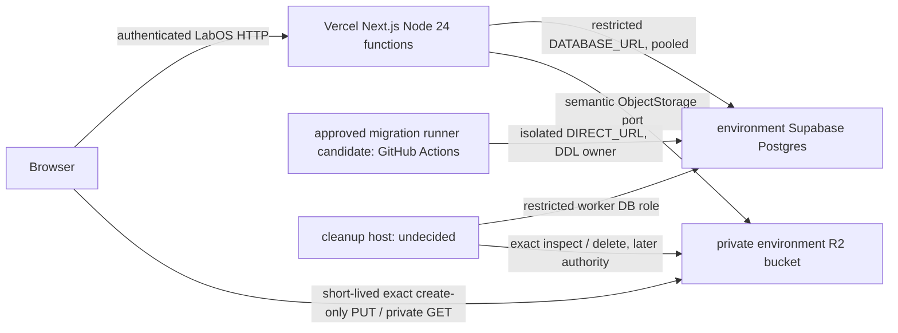

# D1 — LabOS deployment architecture decision

**Product Owner decision (2026-10-08): ACCEPTED | ARCHITECTURE/DECISION.** The topology below is the planning baseline. All target-specific role, connection, migration-runner, backup and cleanup gates remain open; acceptance authorizes no provisioning or implementation.

**Decision scope.** The accepted topology and gates below; no project, role, secret, workflow, migration, worker, schedule or deployment is created by D1. The Product Owner confirms dedicated production Supabase and Vercel projects do not yet exist. This document is therefore **architecture guidance, not target attestation**. [A1-R0](../evidence/files/authorization-v1/n-file-110-a1-r0/packet.md) and the accepted [A1 cleanup contract](authorization-v1/n-file-110-object-storage-cleanup-design.md) are security inputs. R2-01 through R2-06 remain accepted within their recorded limits; N-FILE-110 stays inactive.

## Recommended topology

Vercel hosts the Next.js application and its server-only authorization, Better Auth, Prisma, S001 and object-storage adapter. Browser R2 access is only through short-lived opaque exact-key capabilities issued after server authorization; the bucket remains private. The normal Case DTO and audit records remain capability-free. Files/application → semantic ObjectStorage port ← R2 infrastructure adapter remains unchanged. GitHub Actions is a **preferred migration-runner candidate**, not an approved workflow; the cleanup host and schedule are undecided.

## Environment isolation

| Environment | Application exposure and data | Database / R2 / secrets | Migration and verification boundary |
| --- | --- | --- | --- |
| Local development | Local Next.js; synthetic or authorized development data only. Current Supabase development identity is an owner credential, so it is **not** a production runtime template. | Existing development Supabase project or run-owned disposable PostgreSQL; private non-production R2 target only under prior exact authority. Local ignored env files remain local, never copied to CI/Preview/Production. | Developer-local experiments and approved development migrations only; no production `DIRECT_URL`. A1-I1 remains blocked until its role gate. |
| Protected non-production verification | Dedicated protected Vercel Preview/custom verification environment, selected branches/testers, synthetic non-clinical fixtures. Generic PR previews default to no clinical/database/R2 write credentials. | Separate non-production Supabase project/database, private non-production R2 bucket and independent credentials; no production data copy. If a fixed shared verification project is used, serialize migration/fixture work and isolate run-owned data. | Exact approved migration chain and controlled fixture cleanup; actual browser/private GET, native S001 and type/build checks. Preview must not become public through share links/bypass tokens. |
| Production | Dedicated LabOS Vercel project/Production environment. Case upload server gate remains off until separate activation approval. | Dedicated Supabase project, restricted app role, separate migration owner/worker/function owner, private production R2 bucket/keys and production-only secrets. No local/Preview credential reuse. | Approved, reviewed migration job runs before compatible application release; independently attest project, catalog, connections, backup and rollout. No application build or HTTP request runs DDL. |

Separate Supabase projects provide the primary data boundary. A project per PR could improve isolation but increases project/compute and migration overhead; a single protected verification project is the cost-conscious V1 proposal **only** with run ownership, serialized database changes, synthetic fixtures and no broad Preview credential exposure. Use disposable PostgreSQL for destructive/concurrency matrices. No Preview deployment may point at production Supabase or R2. [Vercel environment variables](https://vercel.com/docs/environment-variables) are deployment/environment scoped and changes affect future deployments, so inspect the effective deployment, not only current dashboard settings.

## Vercel runtime, build and exposure

Use server-side Node.js functions for Prisma/Better Auth/R2 and production S001; no Edge runtime for those boundaries. The accepted S001 target requires Linux x64, Node 24, N-API 10 and actual Julusian/native library mapping identity. Set/attest Node major 24 in the future project and verify build/runtime identity, traced `.node`/`.so`, memory and route bundle before Case activation; Vercel [supports Node 24](https://vercel.com/docs/functions/runtimes/node-js/node-js-versions), but project settings and actual deployment must be checked. Existing `next.config.ts` includes native tracing for completion. The optional whole-snapshot TypeScript check from R2-06 is still INCONCLUSIVE and belongs to A4. Current `next.config.ts` has `logging.fetches.fullUrl: true`; before clinical exposure audit that setting and runtime telemetry against the accepted no-bearer-URL logging rule. Do not infer a leak without a tested path.

Build is not migration authority. A build may package Prisma client/native assets but must not call `migrate dev`, `migrate deploy`, `db push`, or access `DIRECT_URL`. Production artifacts and migration source must correspond to the same approved commit/checksum set. Protect Preview with Vercel Authentication and inspect actual protection and bypass/share-link exposure; [Vercel documents Preview protection](https://vercel.com/docs/deployment-protection). Production domain availability, cohort and activation switch remain separate Product Owner decisions. Vercel rollback of application code does not roll back database schema or outstanding signed capabilities.

## Supabase connections and database identities

Repository truth: [`lib/prisma.ts`](../../lib/prisma.ts) makes a Prisma/pg client from `DATABASE_URL`; [`lib/auth.ts`](../../lib/auth.ts) gives Better Auth that same client; [`prisma.config.ts`](../../prisma.config.ts) uses `DIRECT_URL` for migrations. The current development 6543 runtime versus 5432 session/direct-style URLs use the same owner identity. Read-only development catalog shows that identity owns all 41 public tables and 14 public functions, has `CREATEROLE`, `CREATEDB`, `BYPASSRLS`, and public schema CREATE; no public-table RLS is enabled there. Those are **development observations**, not production assumptions.

For serverless runtime, propose Supabase transaction pooling with a custom restricted LOGIN role; verify current Prisma/pg adapter prepared-statement behavior, connection count/SSL and transaction semantics on the selected project. For the migration runner, prefer a direct connection if its network supports the target's IP family; if not, consider the shared **session** pooler only after an exact Prisma migration compatibility test. Do not use transaction pooling for DDL/migrations or rely on session `SET ROLE`/GUC state. Supabase's [connection guide](https://supabase.com/docs/guides/database/connecting-to-postgres) distinguishes these routes and says direct connections are IPv6 unless the project has the IPv4 add-on; GitHub runner network reachability is a target gate. Supabase [documents custom roles](https://supabase.com/docs/guides/database/postgres/roles), not proof they are installed in the future project.

| Identity | Minimum capabilities | Must not have |
| --- | --- | --- |
| Migration/DDL owner | Controlled `DIRECT_URL`; own/manage LabOS schema, tables, migration history, approved function/trigger/grant changes. Keep credential only in migration environment. | Application/worker deployment secret or request-time use. |
| Ordinary application | LOGIN, CONNECT, schema USAGE, enumerated table SELECT and required INSERT/UPDATE/DELETE for Prisma, Better Auth and LabOS; specific sequence USAGE if future identity columns require it. | Table/schema/function ownership; owner membership or `SET ROLE` path; `CREATEROLE`, `CREATEDB`, `BYPASSRLS`, schema CREATE, TRIGGER/DDL, ACK EXECUTE, migration history writes. |
| Cleanup worker | Separate LOGIN/secret, exact grant/allocation/canonical SELECT, column-scoped claim/lease/retry UPDATE, EXECUTE on one ACK function. Its host is undecided. | Owner membership/assumption, table-wide UPDATE/DELETE/TRUNCATE, DDL, general function EXECUTE, ordinary app/migration credential. |
| ACK function owner | `NOLOGIN`, owns only the narrow `SECURITY DEFINER` function in locked schema; narrow SELECT and grant-column UPDATE. | Table/schema owner, LOGIN, `CREATEROLE`, `BYPASSRLS`, membership reachable by app/worker. |

Do not copy Supabase's generic [privileged Prisma user example](https://supabase.com/docs/guides/database/prisma) into the ordinary runtime role. Enumerate existing application/Better Auth table operations before grants; an overly broad `GRANT ALL ON ALL TABLES` is not the accepted minimum. Existing trigger functions and foreign-key paths must work under non-owner Prisma, including Better Auth sign-in/session, organization and LabOS authorization transactions. Production RLS/managed `anon`, `authenticated`, `service_role` grants must be inventoried; LabOS tenant checks remain server-side and RLS is not silently substituted for them. Grant future objects through reviewed per-migration grants or [creator-specific default privileges](https://www.postgresql.org/docs/current/sql-alterdefaultprivileges.html); table INSERT and sequence USAGE are distinct.

The ACK function accepts grant ID/generation, never caller key/URL/absence claim. Only a restricted worker can execute it after direct semantic ObjectStorage ABSENT. It locks/rechecks terminal grant, exact permanent allocation, live generation/lease, write-expiry-plus-skew fence and no canonical file/version/current pointer, then atomically records CLEANED/confirmation. Ordinary DML is denied by SQL guard; the worker is the remote-attestation authority. Fix `SECURITY DEFINER` search_path to trusted schemas with `pg_temp` last, qualify objects, revoke EXECUTE from PUBLIC and direct API-role grants, and deny app/worker role inheritance/`SET ROLE`, function replacement, trigger alteration or shadow-object creation. See [PostgreSQL function security](https://www.postgresql.org/docs/current/sql-createfunction.html). No function or role is implemented by D1.

The restricted owner transfer needs an explicit, separately authorized installation sequence. PostgreSQL requires the transferring identity to be able to `SET ROLE` to the new function owner **and** that new owner to hold `CREATE` on the function schema at transfer time ([`ALTER FUNCTION` ownership rules](https://www.postgresql.org/docs/current/sql-alterfunction.html)). In one controlled migration transaction, create the migration-owned locked schema and `NOLOGIN` ACK owner; give the ACK owner temporary schema `CREATE` and the migrator temporary, non-inherited role-assumption ability only to perform ownership transfer. Create the qualified function with fixed search path, revoke default `PUBLIC` and direct API-role EXECUTE in that same transaction, grant EXECUTE solely to the cleanup worker, transfer function ownership, then revoke the ACK owner's schema `CREATE` and the migrator's temporary assumption membership **before commit**. The precise membership syntax and permission to perform these steps require target-specific Supabase proof; no app or worker identity may ever assume the owner. After installation, assert the function's owner and search path, migrator ownership of the locked schema, absence of schema `CREATE` for ACK owner/PUBLIC/app/worker, absence of residual `SET ROLE`/inheritance paths to ACK owner, only worker EXECUTE, and active SQL guards. A privileged migration identity remains a deliberately isolated control-plane authority.

Future functions need a reviewed creator-specific default-privilege policy and postflight catalog checks. PostgreSQL gives `PUBLIC` function EXECUTE by default; a per-schema default `REVOKE` cannot cancel a global default grant ([default-privilege rules](https://www.postgresql.org/docs/current/sql-alterdefaultprivileges.html)). Inventory existing functions and compatibility before any separately authorized global default-policy change. Until then, revoke `PUBLIC` EXECUTE for each sensitive function in its creation transaction and verify effective EXECUTE after commit. D1 makes no grant or default-privilege change.

## GitHub Actions migration runner — conditional recommendation

No committed `.github/workflows`, LabOS Vercel project link or production migration runner exists. `package.json` currently defines `pnpm migrate` as **`prisma migrate dev`**; that command is forbidden for production. The pinned repository migration model uses `prisma migrate deploy` through `prisma.config.ts`/`DIRECT_URL`, canonical LF SQL via `.gitattributes`, and checksum/history verification. [Prisma v7 documentation](https://www.prisma.io/docs/orm/v7/prisma-client/deployment/deploy-database-changes-with-prisma-migrate) supports CI `migrate deploy`; its [command reference](https://docs.prisma.io/docs/cli/migrate/deploy) says it does **not** detect drift or compare the Prisma schema, so the job needs separate read-only preflight and post-install verification.

Recommended runner design, subject to separate approval and target proof:

1. Workflow from a protected, reviewed branch or immutable approved commit only. Never run privileged migration secrets with pull-request code, `pull_request_target`, arbitrary `workflow_dispatch` refs, forks or untrusted reusable workflows. Pin third-party actions to reviewed full commit SHAs, minimize job token permissions and serialize one migration job per target. [GitHub's secure-use guidance](https://docs.github.com/en/actions/reference/security/secure-use) recommends SHA pinning and warns about untrusted workflows.
2. Bind each database target to a GitHub Environment with required reviewers, branch restrictions and target-specific secrets, **only if the repository's plan/settings support those controls**. [GitHub environments](https://docs.github.com/en/actions/concepts/workflows-and-actions/deployment-environments) release secrets after protection checks; [plan limitations](https://docs.github.com/en/actions/how-tos/managing-workflow-runs-and-deployments/managing-deployments/reviewing-deployments) must be attested before relying on required reviewers in a private repository. No automatic production migration on every push.
3. Runner gets only the migration owner's `DIRECT_URL` for that approved target, not R2 or application secrets. Prefer short-lived brokered credentials if an actual supported provider path exists; GitHub OIDC alone is **not** PostgreSQL authentication. Otherwise use a protected environment secret with explicit custodian/rotation, never echo it, write it to artifacts, or pass it on command lines. Attest TLS, region/network reachability and exact DB/project fingerprint before any DDL.
4. Preflight approved commit/migration manifest, canonical LF bytes and SHA-256, `_prisma_migrations` applied checksums, pending set, backup/PITR availability, current schema/role/catalog and required table data guards. A mismatch stops before DDL; do not `migrate resolve` or rewrite history to force a pass. Apply only reviewed pending migrations once via pinned Prisma CLI `migrate deploy`. Postflight verifies ledger checksums, schema, triggers, grants, role denial and application compatibility. Retain sanitized logs only.
5. Install additive, backward-compatible DB expansion **before** the matching Vercel release. Defer destructive contract changes to separate gates. If migration fails partially, stop deployment and use reviewed repair; if installed SQL is wrong, forward correction or authorized restore is required. [Prisma rollback guidance](https://www.prisma.io/docs/orm/migrations/rollbacks-and-recovery) does not make app rollback a DB rollback. Supabase backups/PITR and an actual restore rehearsal need their own authorization.

GitHub Actions is preferred to running migrations in Vercel builds or from developer laptops because its environment-scoped job can separate DDL credentials from HTTP runtime. It is **not yet accepted**: private-repository approval controls, runner IP connectivity to direct Supabase, secret custody, migration-history provenance and rollback rehearsal are unresolved. A controlled self-hosted/IPv6 runner or separately approved deployment platform is an alternative if GitHub-hosted reachability or protection fails; it adds host maintenance and secret boundary work. Supabase branching/automatic migration integration would introduce a second migration authority and is not selected.

## Auth, object storage and secret routing

`BETTER_AUTH_SECRET` and `BETTER_AUTH_URL` are per-environment server configuration. Changing the secret can invalidate sessions; URL/cookie/origin behavior must be verified for protected Preview versus Production domains. Better Auth uses the ordinary restricted Prisma client, never a migration credential. LabOS authorization still resolves authenticated session → active Organization → verified Member → Organization-linked Lab and authorizes before provider/domain access. Neither Preview protection nor UI visibility is a substitute.

Vercel runtime receives only its restricted `DATABASE_URL`, Better Auth keys, approved observability configuration and environment-specific private R2 adapter credentials. `DIRECT_URL`, ACK-worker DB credential, GitHub migration secret and Supabase administrative credentials are absent from Vercel functions and build output. Use Vercel environment-scoped sensitive variables where supported; inspect effective deployment variable names and access, never export values into evidence. [Vercel sensitive variables](https://vercel.com/docs/environment-variables/sensitive-environment-variables) hide values after creation. R2 bucket/account/endpoint/SigV4/ETag stay infrastructure details. Per-environment private bucket, least-privilege key, CORS limited to exact approved browser origins/methods/headers, no `r2.dev` or public custom domain, no bearer URL in logs/DTOs/persistence. The existing non-production R2 conformance bucket is not automatically a production bucket.

## Region, cost and disaster recovery

Choose an exact Supabase production region, Vercel function region and R2 placement **after** Product Owner data-residency, user geography and latency requirements. Keep server function close to Supabase for transactional work; measure R2 direct browser write/read and second server retrieval in the actual target. Supabase [region guidance](https://supabase.com/docs/guides/platform/regions) says its region determines primary project data location. Cloudflare [R2 location hints](https://developers.cloudflare.com/r2/reference/data-location/) are best effort, while jurisdiction restrictions are the enforceable residency control. Do not infer compliance or choose a region from user timezone.

Minimum infrastructure: separate production and protected non-production Supabase projects, private environment-specific R2 buckets/credentials, a production Vercel project with protected Preview configuration, separate migration secret environment, monitored TLS/pool capacity, and backup/restore ownership. Each Supabase project adds compute spend ([Supabase compute usage](https://supabase.com/docs/guides/platform/manage-your-usage/compute)); R2 bills storage/operations and its class choice affects retrieval/minimum duration ([R2 pricing](https://developers.cloudflare.com/r2/pricing/)). Cost-sensitive V1: one protected shared non-production project plus disposable DB tests, small initial compute after load proof, standard R2 storage, no per-PR clinical project/credential. Exact prices/plans are target-specific and must be rechecked before purchase.

Assign database backup, PITR retention, restore-test owner, RTO/RPO and incident access before production exposure. [Supabase backups](https://supabase.com/docs/guides/platform/backups) vary by plan and PITR add-on; a DB backup does **not** restore private R2 bytes. Separately design private object backup/copy or recovery reconciliation, key-ledger/evidence-to-object inventory, same-key length/SHA verification, and exact orphan/canonical treatment under approved authority. Never restore DB to a point incompatible with R2 object state or assume bucket deletion/accidental overwrite is reversible. No backup policy or object copy is created here.

## Cleanup host boundary and explicit gates

Cleanup host and schedule are **undecided**. Candidate later options are a separately credentialed scheduled Vercel function (simpler deployment, but job duration/overlap/pool/secret containment need proof) or a dedicated worker/container (more control over leases and retries, higher operating burden). Either must use a worker-only DB credential and ObjectStorage semantic port, never share the ordinary Vercel app role or migration owner, and never DELETE before terminal state + latest write expiry + 60-second skew and accepted in-flight-PUT conformance. Exact absence precedes trusted ACK; canonical CONSUMED assets are excluded. A1-I1 persistence/role work does not schedule or execute deletion; A1-I2 and A5 need separate decisions.

The ordered gates to resume A1-I1 are:

1. **D1 Product Owner architecture decision — COMPLETE:** the topology, isolated environments and conditional migration-runner direction are accepted as a planning baseline. **D2 target selection** is the next Product Owner decision; its project/owner/region/plan choices remain open and do not authorize provisioning.
2. **Provisioning authority:** separately authorize named non-production and production Vercel/Supabase/R2 resources, owner/region/plan, protected environments and secrets. No D1 write authority.
3. **Read-only target attestation:** exact project IDs/fingerprints, region, provider plan/network, Vercel effective environment names, Supabase role/ownership/membership/ACL/RLS, migration-runner branch/environment protections, no production secret in Preview, approved backup capability. This resolves A1-R0's target evidence gap.
4. **Role/configuration authority and verification:** separately authorize restricted app/worker/no-login function-owner roles, credentials, grants and connection configuration on an approved target; prove direct/session/transaction route behavior and Better Auth/Prisma compatibility, deny owner assumptions/ACK bypass, and rehearse rollback. A disposable role split alone is not target proof.
5. **A1-I1 resumption decision:** after gates 3–4 show feasible separation, Product Owner separately resumes exact additive persistence/trusted writer candidate with disposable PostgreSQL and independent V3 CODE/SQL + RUNTIME_EVIDENCE. Normal-development/production installation remains separate authority.
6. **Later lifecycle/activation:** A1-I2 real cleanup behavior, A2–A5, N-FILE-110 activation and deployment each retain their accepted separate authority and verification requirements.

## Unresolved Product Owner decisions

| Decision | Why it cannot be inferred from D1 |
| --- | --- |
| Supabase and Vercel organization/project ownership, target plan and exact production/protected-non-production regions | No dedicated production projects exist; affects residency, cost, access and network. |
| Whether protected verification uses one fixed project or per-branch ephemeral projects | Cost versus isolation and concurrency trade-off; no clinical data allowed in either. |
| GitHub repository visibility/plan and migration approval owner; whether GitHub Actions is accepted after controls/network proof | Required reviewers for a private repo may be plan-limited; no workflow/runner exists. |
| Credential custodian/rotation, direct IPv6 access or session-pooler alternative, deployment order and emergency owner-credential rollback approval | Security and availability decisions requiring actual targets. |
| Production backup/PITR tier, RTO/RPO, R2 recovery method and restore-test owner | DB backup alone does not recover object bytes; cost and data-loss tolerance are product decisions. |
| Initial audience/exposure, cleanup host/schedule, telemetry owner/thresholds | These belong to A1-I2/A5 and are not implied by D1. |

D1 is **ACCEPTED | ARCHITECTURE/DECISION** as a planning baseline following independent V3 PASS. This acceptance is not target-specific role attestation, infrastructure provisioning, A1-I1 resumption or feature activation. Before production exposure, separately settle backup/recovery objectives and clinical-data protection. Before destructive cleanup, prove the accepted in-flight R2 PUT fence. A1-I1 remains BLOCKED_DECISION; N-FILE-110 remains inactive.

Independent V3 ARCHITECTURE/DECISION review: **PASS** after correction of the ACK ownership-transfer installation sequence. The initial review identified that gap; the rereview found no remaining material finding. This is design review only: provisioning, role feasibility on the intended Supabase target, runtime, migration installation and activation remain NOT_RUN.

